# 📊 UIII Act3: Importación y Descripción de Datos
## Hugo Fabian NC 0040
> **🎓 Asignatura:** Soluciona problemas de Machine Learning  
> **📚 Nivel:** Tercer semestre de preparatoria  
> **🤖 Especialidad:** Inteligencia Artificial  
> **📈 Dificultad:** Cero a principiante  
> **🐍 Lenguaje:** Python  
> **🛠️ Herramientas:** Visual Studio Code, Pandas, Matplotlib y CSV  
## empleados de industria

## TABLA ORIGINAL DE EMPLEADOS
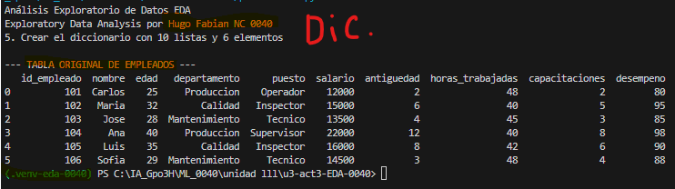
## 7. Convertir el DataFrame en archivo CSV
¿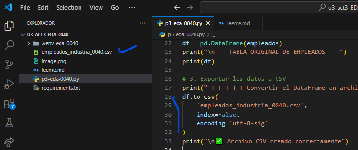
## datos del cvs-->
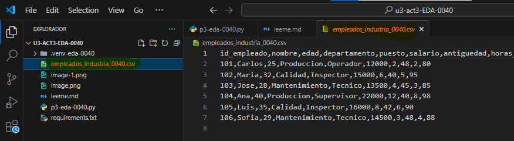
## 8. leer los datos desde elarchivo csv
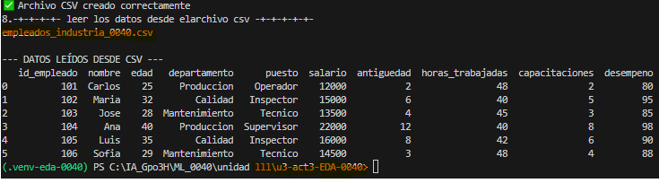
## Análisis Exploratorio de Datos (EDA)
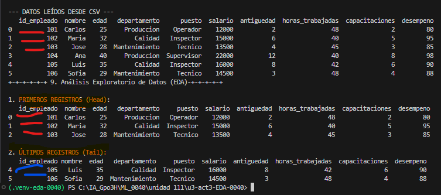
## Dimensiones y estructura
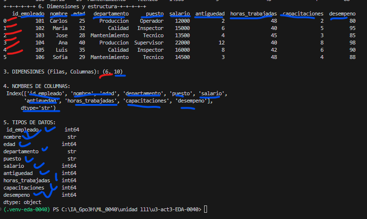
## estadisticas y limpieza
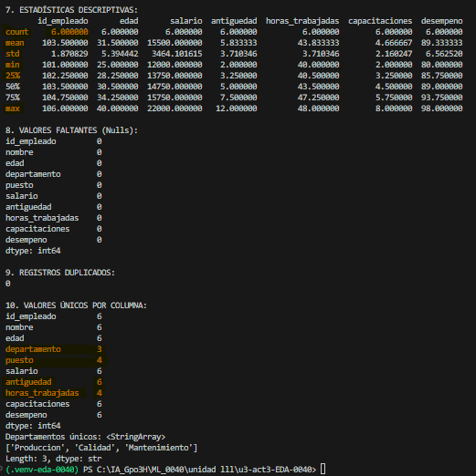
## 8 y 9 ordenamiento, filtrado y agrupacion
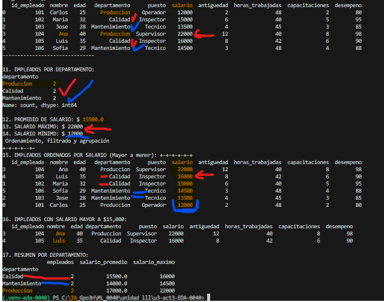
## grafu¿ica de barras : empleados por departamentos
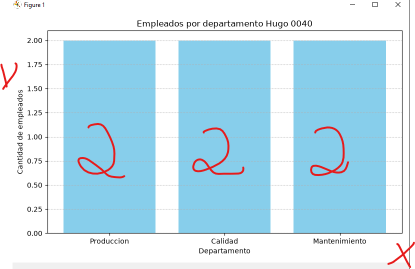
## grafica de barras: Salarios por empleado
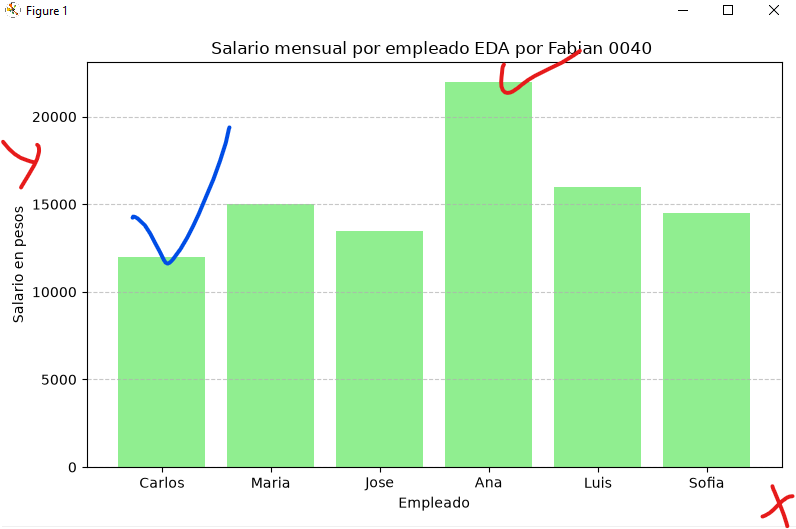
## # 20. Histograma: Distribución de edades
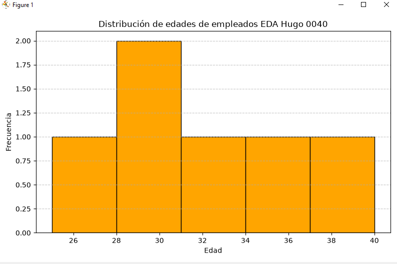
## 21. Gráfica de dispersión: Edad vs Salario
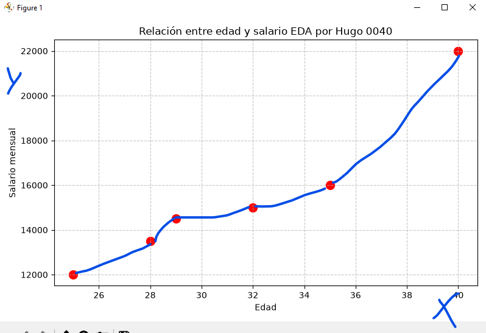
## 22. Diagrama de caja: Distribución de salarios
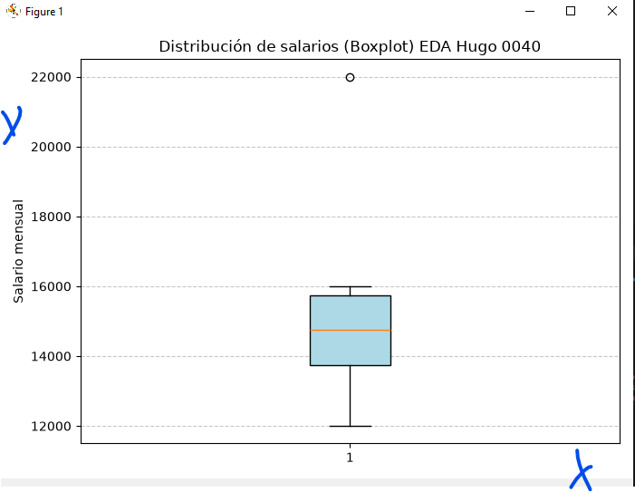
## 23. Matriz de correlación
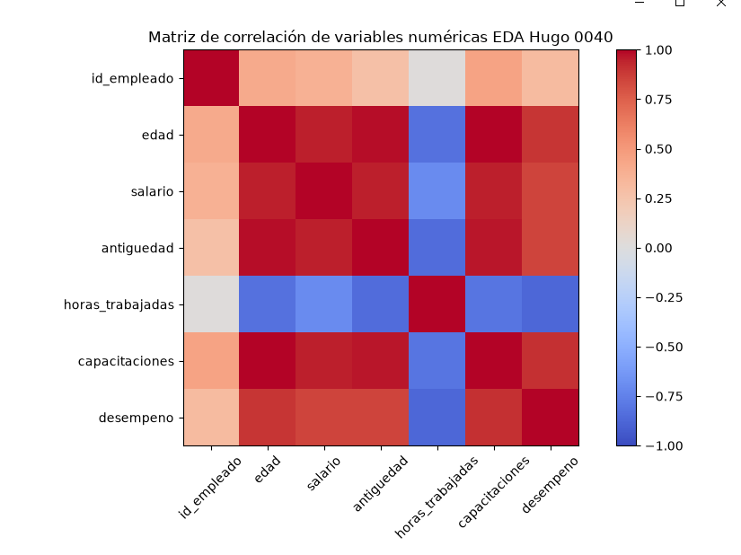